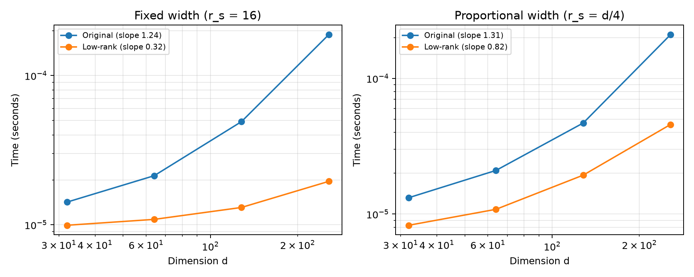
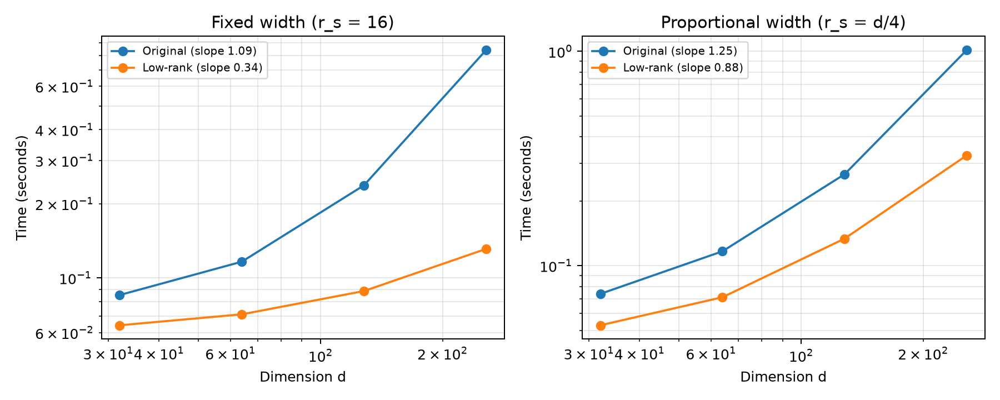
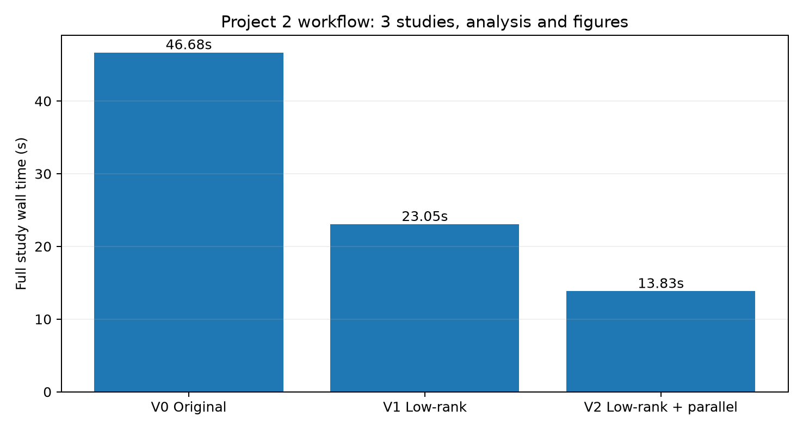

# Optimization

I focused on two changes to the Project 2 simulation: reducing the cost of evaluating the gradient-flow ODE and running independent trajectories in parallel. I also tested vectorizing the risk calculation after integration.

## 1. Bottleneck

The original `make all` took **47.615 s**, including simulation, analysis, and plotting. The `d=256` width experiment took 33.67 s of that time. I profiled one trajectory with `d=256`, `r_s=64`, and `T=160` using `cProfile`.

| Function | Calls | Cumulative time |
| --- | ---: | ---: |
| `solve_ivp` | 1 | 2.225 s |
| `rhs` | 9,398 | 2.023 s |
| `population_risk_and_gradients` | 9,499 | 1.944 s |

The risk/gradient function took about **86.6%** of the simulation time. It repeatedly formed dense `d × d` matrices, so this was the first part I optimized. More baseline measurements are in [BASELINE.md](BASELINE.md).

## 2. Low-rank computation (Algorithmic Improvements)

The original gradient calculation used:

```python
G = (W @ W.T) / r_s
weighted = lam[:, None] * (G - B) * lam[None, :]
grad_W = (4 / r_s) * (weighted @ W) - (2 * e / r_s) * (lam[:, None] * W)
```

Here `W` has shape `d × r_s`, and both the covariance matrix $\Sigma$ and teacher matrix $B$ are diagonal. With $K=W^\top\Sigma W$, the gradient-flow equation can be written as

$$
\dot W=-\frac{4}{r_s}(\Sigma W)K+4\Sigma B\Sigma W+2e\Sigma W,
\qquad e=b-\frac{\operatorname{tr}(K)}{r_s}.
$$

In `src/methods_optimized.py`, this becomes:

```python
SW = lam[:, None] * W
gram = W.T @ SW
e = b - np.sum(W * SW) / r_s
dW = -(4.0 / r_s) * (SW @ gram) + 4.0 * teacher_weight[:, None] * W + 2.0 * e * SW
```

`teacher_weight = lam**2 * np.diag(B)` is computed once before integration. I also removed risk evaluation from the ODE RHS, since the solver only needs the derivatives; risks are still evaluated at the saved time points.

The leading matrix work per RHS evaluation changes from $O(d^2r_s)$ to $O(dr_s^2)$. The resulting trajectory timings were:

| Setting | Original | Low-rank | Speedup |
| --- | ---: | ---: | ---: |
| `d=32, r_s=16, T=80` | 0.0855 s | 0.0638 s | 1.34× |
| `d=256, r_s=64, T=160` | 2.1766 s | 0.6994 s | 3.11× |

These are medians of five runs. In the profiler, the main calculation took 1.944 s in the original risk/gradient function and 0.434 s in `low_rank_field`; both solvers made 9,398 RHS evaluations. Maximum resident memory in a separate `d=256` comparison decreased from **133.0 to 128.9 MiB** (about 3.1%). The low-rank code is more specialized to diagonal $\Sigma$ and $B$, and its algebra is less immediately readable than the direct matrix expression.

## 3. Parallel simulation (Parallelization)

Even with the faster RHS, Project 2 ran its trajectories sequentially. The original simulation used nested loops over width, replicate, and covariance exponent (abbreviated):

```python
for rs in widths:
    for rep in range(n_rep):
        # initialize W0 and b0
        for beta in betas:
            # construct the model and solve the ODE
            t, risks, biases = solve_paper_population_gf(...)
```

I grouped the work by `(student_width, replicate)` and ran the jobs with `ProcessPoolExecutor`:

```python
jobs = [(cfg, int(width), rep)
        for width in cfg["student_widths"]
        for rep in range(int(cfg["n_replicates"]))]

with ProcessPoolExecutor(
    max_workers=workers, mp_context=mp.get_context("spawn")
) as pool:
    batches = list(pool.map(run_job, jobs))
```

Each job uses a seed based on `(master_seed, d, width, replicate)`, and the same initialization is reused across its `beta` values. The parallel implementation is in `scripts/benchmark_parallel.py` and `scripts/run_optimized_study.py`.

For the 15-trajectory `d=256` width experiment:

| Workers | Median time | Speedup | Efficiency |
| --- | ---: | ---: | ---: |
| 1 | 12.162 s | 1.00× | 100% |
| 2 | 7.488 s | 1.62× | 81% |
| 4 | 5.739 s | 2.12× | 53% |

Each worker setting was timed three times, with one BLAS thread per process. All 1,515 saved time-point records matched across worker counts. Four workers were fastest among those tested, but the speedup was not linear because of process startup, scheduling, and shared resources.

## 4. Scaling and full-study results

I measured both individual RHS evaluations and complete ODE solves at `d=32, 64, 128, 256`, using fixed width `r_s=16` and proportional width `r_s=d/4`. At `d=256`, the full-ODE speedup was **6.42×** for fixed width and **3.10×** for proportional width. The fitted full-ODE log-log slopes were 1.09 vs. 0.34 for fixed width and 1.25 vs. 0.88 for proportional width (original vs. low-rank). These are empirical slopes over the four tested dimensions, rather than estimates from a large-dimensional regime.





I also reran the complete Project 2 workflow—three experiments, analysis, and figures—three times for each version:

| Version | Median time | Speedup vs. V0 |
| --- | ---: | ---: |
| V0: original, serial | 46.678 s | 1.00× |
| V1: low-rank, serial | 23.051 s | 2.02× |
| V2: low-rank, 4 workers | 13.834 s | **3.37×** |



Overall, the full workflow took about **70% less time** with both optimizations.

## 5. Correctness and numerical checks

The test suite passed **24 tests**. Baseline and optimized stability checks each passed **11/11** cases, with no captured warnings, solver failures, or flagged risk diagnostics.

In the full-study comparison, population risks agreed closely (maximum difference `3.536e-10`). Six `bias_mismatch` values in the `d=256` experiment exceeded the initial comparison tolerance, with a maximum difference of `1.360e-5` at `r_s=128`, replicate 0. Using tighter RK45 tolerances (`rtol=1e-8`, `atol=1e-10`) reduced the maximum difference between the two implementations to `4.263e-13`. This is consistent with sensitivity to the numerical integration tolerances. V1 and V2 produced identical saved outputs in the full-study comparison.

## 6. Lessons learned

The low-rank calculation helped most because it reduced work in a function called thousands of times. Parallelization helped further, although the benefit per additional worker decreased.

I also tried vectorizing risk evaluation across saved time points. It was faster than a low-rank loop at `d=32` (**0.218 vs. 0.530 ms**), but slower at `d=256` (**6.620 vs. 5.182 ms**), so I kept the loop. This was a useful reminder that removing Python loops does not always reduce runtime.

The experiments can be reproduced with `make profile`, `make complexity`, `make benchmark`, `make parallel`, `make stability-check`, and `make test`. The corresponding scripts and measurements are in `scripts/` and `results/performance/`.
